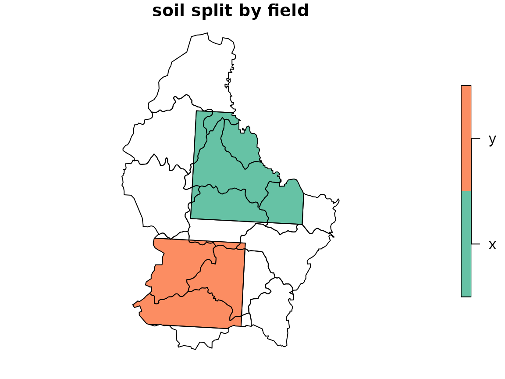
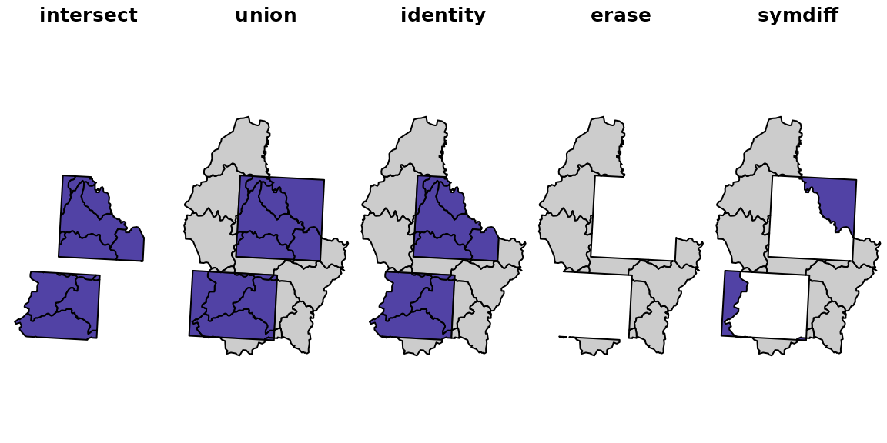
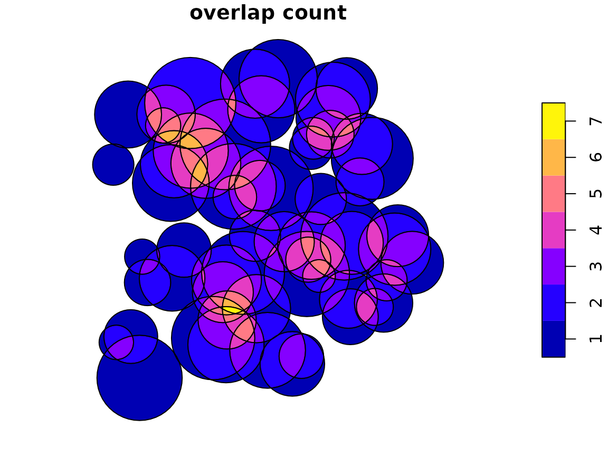

# Identity and n-ary overlay with polymer

Two long-standing requests on the ‘sf’ issue tracker ask for overlays
that pairwise clipping handles awkwardly:

- [r-spatial/sf#1959](https://github.com/r-spatial/sf/issues/1959) asks
  for an equivalent of the Esri *Identity* overlay: split the polygons
  of one layer by the boundaries of another and keep the attributes of
  both.
- [r-spatial/sf#2242](https://github.com/r-spatial/sf/issues/2242) asks
  for a faster and more robust n-ary intersection of a single layer:
  every piece of the plane with the number of polygons covering it, and
  which ones.

polymer answers both with the same two steps.
[`polymer()`](https://hypertidy.github.io/polymer/reference/polymer.md)
puts every edge of every input into one triangulation and records which
features cover each triangle, and
[`fuse()`](https://hypertidy.github.io/polymer/reference/fuse.md)
dissolves the triangles into one piece per distinct set of covering
features. The rest is bookkeeping on the `origins` of each piece.

This vignette also sets out where ‘sf’ and where ‘wk’ belong in such a
workflow. In short: prepare the inputs with ‘sf’, hand the ‘sf’ objects
to
[`polymer()`](https://hypertidy.github.io/polymer/reference/polymer.md)
as they are, do the bookkeeping on polymer’s own tables, and convert
back to ‘sf’ once, at the end.

``` r

library(polymer)
```

## Where conversion to wk belongs

polymer reads anything the ‘wk’ package can handle, ‘sf’ data frames
included, and converts the geometry to well-known binary itself.
Converting an ‘sf’ layer with
[`wk::as_wkb()`](https://paleolimbot.github.io/wk/reference/wkb.html)
before calling
[`polymer()`](https://hypertidy.github.io/polymer/reference/polymer.md)
gains nothing: the conversion takes a fraction of a millisecond for the
example layers here, and passing the ‘sf’ data frame lets polymer keep
its attribute columns and check that all layers share a coordinate
reference system.

What matters is what has to happen *before* the geometry leaves ‘sf’,
because ‘wk’ cannot do it:

1.  **Project to a planar CRS.** polymer works in the plane. Edges are
    straight lines in the input coordinates and crossings are computed
    in those coordinates. With longitude and latitude the result is a
    valid planar overlay in degrees, but ‘sf’ measures the same polygons
    with geodesic edges (via ‘s2’, or ‘lwgeom’ when ‘s2’ is off), so
    areas and comparisons no longer line up. Use
    [`sf::st_transform()`](https://r-spatial.github.io/sf/reference/st_transform.html)
    first.
2.  **Repair and select.** Use
    [`sf::st_make_valid()`](https://r-spatial.github.io/sf/reference/valid.html)
    if the input needs it, and drop attribute columns you do not want
    carried through.

After
[`polymer()`](https://hypertidy.github.io/polymer/reference/polymer.md),
everything needed for the overlay is already in plain R structures: the
layer attributes in `pool$layers`, the covering features of each piece
in `pieces$origins`, and the triangles in `pool$mesh`. There is no
reason to go back to ‘sf’ in the middle, for example to drop geometry
with
[`sf::st_drop_geometry()`](https://r-spatial.github.io/sf/reference/st_geometry.html)
or to measure areas. Pieces stay as
[`wk::wkb()`](https://paleolimbot.github.io/wk/reference/wkb.html) until
the end, where one call to
[`sf::st_as_sf()`](https://r-spatial.github.io/sf/reference/st_as_sf.html)
gives an ‘sf’ data frame for plotting, writing or comparison.

The example layers `soil` and `field` are in longitude and latitude, so
they are projected first, here to the European equal-area projection.

``` r

soil_p <- sf::st_transform(soil, 3035)
field_p <- sf::st_transform(field, 3035)
```

## Identity (sf#1959)

Identity keeps every part of the input layer `x`, split along the
boundaries of the identity layer `y`, with the attributes of both. Parts
of `x` outside `y` get missing values for `y`’s attributes, and parts of
`y` outside `x` are dropped.

With polymer that is a filter on the origins of each piece: keep the
pieces with a layer-1 origin, and look up the attributes of the layer-1
and layer-2 features listed there in `pool$layers`.

``` r

identity_pieces <- function(pool, pieces) {
  map <- do.call(rbind, lapply(seq_len(nrow(pieces)), function(i) {
    o <- pieces$origins[[i]]
    fx <- o$feature[o$layer == 1L]
    fy <- o$feature[o$layer == 2L]
    if (!length(fx)) return(NULL)        # only in y: dropped
    if (!length(fy)) fy <- NA_integer_   # only in x: y attributes missing
    expand.grid(piece = i, x = fx, y = fy)
  }))
  out <- data.frame(pool$layers[[1L]][map$x, , drop = FALSE],
                    pool$layers[[2L]][map$y, , drop = FALSE])
  rownames(out) <- NULL
  out$geometry <- pieces$geometry[map$piece]
  out
}
```

The function only touches polymer’s tables, so it needs neither ‘sf’ nor
‘wk’ beyond indexing a
[`wk::wkb()`](https://paleolimbot.github.io/wk/reference/wkb.html)
vector.

``` r

pool <- polymer(soil_p, field_p)
pool
#> polymer mesh:
#> Layers:    2
#> Features:  14
#> Triangles: 4166
#> Vertices:  2306 (21 at crossings)
#> Overlaps:  2224 triangles covered more than once, at most 2 deep
ident <- identity_pieces(pool, fuse(pool))
head(ident)
#>   soil field
#> 1    D     y
#> 2    A  <NA>
#> 3    E  <NA>
#> 4    C     y
#> 5    B  <NA>
#> 6    A     x
#>                                                                                                                    geometry
#> 1 <MULTIPOLYGON (((4044330 2942275, 4044160 2942147, 4043615 2941663, 4043392 2941475, 4043216 2941346, 4043014 2941224...>
#> 2 <MULTIPOLYGON (((4057798 2939181, 4058361 2939412, 4058083 2941407, 4057571 2941276, 4057531 2941851, 4057564 2941977...>
#> 3 <MULTIPOLYGON (((4027533 2979908, 4027765 2979938, 4028097 2980021, 4028200 2980057, 4028313 2980123, 4028411 2980210...>
#> 4 <MULTIPOLYGON (((4023563 2962512, 4023482 2962427, 4023253 2961507, 4023258 2960769, 4023701 2960023, 4024480 2959486...>
#> 5 <MULTIPOLYGON (((4052867 2955215, 4052886 2954981, 4052905 2954906, 4052957 2954779, 4053099 2954548, 4053270 2954251...>
#> 6 <MULTIPOLYGON (((4036969 2990324, 4036981 2989737, 4037004 2989601, 4037104 2989172, 4037345 2989265, 4037461 2989323...>
```

Now convert, once.

``` r

ident <- sf::st_as_sf(ident)
plot(ident["field"], main = "soil split by field")
```



### Checking against the pairwise workaround

The workaround in the issue intersects the layers, takes the difference
of `x` and the union of `y`, and binds the two. Written with base
[`rbind()`](https://rdrr.io/r/base/cbind.html):

``` r

pairwise_identity <- function(x, y) {
  x <- sf::st_set_agr(x, "constant")
  y <- sf::st_set_agr(y, "constant")
  inter <- sf::st_intersection(x, y)
  rest <- sf::st_difference(x, sf::st_union(y))
  rest[setdiff(names(y), attr(y, "sf_column"))] <- NA
  rest <- sf::st_set_geometry(rest, attr(inter, "sf_column"))
  rbind(inter, rest)
}
base <- pairwise_identity(soil_p, field_p)
c(polymer = nrow(ident), pairwise = nrow(base))
#>  polymer pairwise 
#>       25       25
```

Both give the same pieces. Total area per combination of soil and field
values agrees to rounding:

``` r

key <- function(d) paste(d$soil, d$field)
a_poly <- tapply(as.numeric(sf::st_area(ident)), key(ident), sum)
a_pair <- tapply(as.numeric(sf::st_area(base)), key(base), sum)
range(a_poly / a_pair[names(a_poly)] - 1)
#> [1] -6.050715e-13  8.231194e-13
```

### Checking with the mesh alone

The mesh can check itself, with no polygon geometry at all. Each
triangle’s area comes from its three vertices, and `pool$index` says
which features cover it, so the area of every input feature is a sum
over its triangles.

``` r

tri_area <- function(pool) {
  v <- wkpool::pool_vertices(pool$mesh)
  t <- wkpool::pool_triangles(pool$mesh)
  i <- match(t$.vx0, v$.vx)
  j <- match(t$.vx1, v$.vx)
  k <- match(t$.vx2, v$.vx)
  ((v$x[j] - v$x[i]) * (v$y[k] - v$y[i]) -
     (v$x[k] - v$x[i]) * (v$y[j] - v$y[i])) / 2
}
ta <- tri_area(pool)
idx <- pool$index
by_feature <- tapply(ta[idx$triangle], list(idx$layer, idx$feature), sum)
range(by_feature[1L, ] / as.numeric(sf::st_area(soil_p)) - 1)
#> [1] -7.035483e-13  1.989520e-13
```

The triangles reproduce every soil polygon’s area, so splitting by
`field` lost nothing.

### A point to settle

[`expand.grid()`](https://rdrr.io/r/base/expand.grid.html) above gives
one row for each pair of covering `x` and `y` features. When features
within a layer overlap each other, a piece is covered by several
features of one layer, and it is repeated once per pair. The Esri
documentation does not describe this case, and whether to repeat,
aggregate or reject such pieces is a choice for the caller. The soil and
field layers have no internal overlaps, so it does not arise here.

## One mesh, the whole overlay family

Identity is one of several two-layer overlays that GIS software offers
side by side: Intersect, Union, Identity, Erase and Symmetrical
Difference. Pairwise clipping computes each one separately, from the
geometry. With polymer they are all filters on the same pieces, decided
only by whether a piece has a layer-1 origin, a layer-2 origin, or both.
The mesh is built once.

``` r

pieces <- fuse(pool)
in_x <- vapply(pieces$origins, function(o) any(o$layer == 1L), logical(1))
in_y <- vapply(pieces$origins, function(o) any(o$layer == 2L), logical(1))
keep <- list(
  intersect = in_x & in_y,
  union = in_x | in_y,
  identity = in_x,
  erase = in_x & !in_y,
  symdiff = xor(in_x, in_y)
)
```

Pieces covered by a field polygon are filled purple, the rest grey.

``` r

op <- par(mfrow = c(1, 5), mar = c(0, 0, 1.5, 0), xaxt = "n", yaxt = "n", bty = "n")
for (nm in names(keep)) {
  wk::wk_plot(pieces$geometry, border = NA)
  title(nm)
  wk::wk_plot(pieces$geometry[keep[[nm]]], add = TRUE,
              col = c("grey80", "#5142A5")[in_y[keep[[nm]]] + 1L])
}
```



``` r

par(op)
```

Each filter’s area agrees with the corresponding ‘sf’ operation on the
unioned layers:

``` r

area <- as.numeric(sf::st_area(sf::st_as_sfc(pieces$geometry)))
ux <- sf::st_union(soil_p)
uy <- sf::st_union(field_p)
sf_area <- function(g) sum(as.numeric(sf::st_area(g)))
cbind(polymer = vapply(keep, function(k) sum(area[k]), numeric(1)),
      sf = c(sf_area(sf::st_intersection(ux, uy)),
             sf_area(sf::st_union(ux, uy)),
             sf_area(ux),
             sf_area(sf::st_difference(ux, uy)),
             sf_area(sf::st_sym_difference(ux, uy))))
#>              polymer         sf
#> intersect 1113655938 1113655938
#> union     2893864227 2893864227
#> identity  2564810460 2564810460
#> erase     1451154522 1451154522
#> symdiff   1780208288 1780208288
```

The filters work on any number of layers in the same way. A piece’s
`origins` is the full record of what covers it, so any rule over layers
and features, such as “in layer 1 and layer 3 but not layer 2”, is a
logical expression on that table rather than a sequence of clipping
operations.

## n-ary intersection of one layer (sf#2242)

For a single layer, `fuse(polymer(x))` is the n-ary intersection: one
piece per distinct set of covering features, with the count in `n` and
the features in `origins`. The example is overlapping discs, with one
disc duplicated, because the loop posted in the issue stops on duplicate
geometries.

``` r

make_discs <- function(n, seed = 1) {
  set.seed(seed)
  pts <- sf::st_as_sf(data.frame(x = runif(n, 0, 100), y = runif(n, 0, 100),
                                 id = seq_len(n)),
                      coords = c("x", "y"))
  sf::st_buffer(pts, dist = runif(n, 5, 15), nQuadSegs = 12)
}
discs <- make_discs(60)
discs <- rbind(discs, discs[1, ])

pool <- polymer(discs)
pool
#> polymer mesh:
#> Layers:    1
#> Features:  61
#> Triangles: 5932
#> Vertices:  3268 (388 at crossings)
#> Overlaps:  4554 triangles covered more than once, at most 7 deep
pieces <- fuse(pool)
table(pieces$n)
#> 
#>   1   2   3   4   5   6   7 
#>  47  97 104  72  33  13   3
```

The duplicate needs no special handling: discs 1 and 61 cover the same
triangles, so they appear together in the origins of every piece inside
disc 1.

``` r

has_both <- vapply(pieces$origins,
                   function(o) all(c(1, 61) %in% o$feature), logical(1))
pieces$origins[[which(has_both)[1L]]]
#>   layer feature
#> 1     1       1
#> 2     1      19
#> 3     1      25
#> 4     1      61
```

The input `id` column is in `pool$layers`, so mapping origins to ids is
again plain indexing. Then convert once and plot the overlap count.

``` r

pieces$ids <- lapply(pieces$origins, function(o) pool$layers[[1L]]$id[o$feature])
nary <- sf::st_as_sf(pieces[c("n", "ids", "geometry")])
plot(nary["n"], main = "overlap count")
```



### Checking against st_intersection()

[`sf::st_intersection()`](https://r-spatial.github.io/sf/reference/geos_binary_ops.html)
on one layer computes the same partition. It returns one row per piece,
and can include points, lines and collections where boundaries touch,
while polymer returns one MULTIPOLYGON per covering set, so rows do not
compare directly. Area per overlap count does:

``` r

sf_nary <- sf::st_intersection(discs)
types <- table(sf::st_geometry_type(sf_nary))
types[types > 0]
#> 
#>              POINT         LINESTRING            POLYGON    MULTILINESTRING 
#>                  4                 22                283                 26 
#>       MULTIPOLYGON GEOMETRYCOLLECTION 
#>                 78                 69

a_poly <- as.numeric(sf::st_area(nary))
rbind(polymer = tapply(a_poly, nary$n, sum),
      sf = tapply(as.numeric(sf::st_area(sf_nary)), sf_nary$n.overlaps, sum))
#>                1        2        3        4        5        6        7
#> polymer 3149.089 3115.716 2030.523 878.2377 356.7628 85.49982 10.31411
#> sf      3149.089 3115.716 2030.523 878.2377 356.7628 85.49982 10.31411
```

Because the pieces partition the covered area, two more identities hold:
area weighted by overlap count equals the summed area of the discs, and
plain area equals the area of their union.

``` r

c(sum(nary$n * a_poly) / sum(as.numeric(sf::st_area(discs))),
  sum(a_poly) / as.numeric(sf::st_area(sf::st_union(discs)))) - 1
#> [1] 2.220446e-16 6.661338e-16
```

### Timing

The reason for the issue is speed. The timings below were recorded once
(on a Linux cloud machine, GEOS 3.12.1) rather than run when the
vignette is built, because the ‘sf’ call becomes slow as the number of
discs grows.

``` r

for (k in c(50, 100, 200)) {
  p <- make_discs(k, seed = k)
  t_mesh <- system.time(pool <- polymer(p))[["elapsed"]]
  t_fuse <- system.time(fuse(pool))[["elapsed"]]
  t_sf <- system.time(r <- sf::st_intersection(p))[["elapsed"]]
  cat(k, t_mesh, t_mesh + t_fuse, t_sf, nrow(r), nrow(fuse(pool)), "\n")
}
```

| discs | [`polymer()`](https://hypertidy.github.io/polymer/reference/polymer.md) (s) | [`polymer()`](https://hypertidy.github.io/polymer/reference/polymer.md) + [`fuse()`](https://hypertidy.github.io/polymer/reference/fuse.md) (s) | `st_intersection()` (s) | sf rows | polymer pieces |
|---:|---:|---:|---:|---:|---:|
| 50 | 0.04 | 0.18 | 0.07 | 222 | 201 |
| 100 | 0.06 | 0.43 | 1.38 | 1611 | 1059 |
| 200 | 0.24 | 1.32 | 71.99 | 19199 | 4467 |

For small inputs the two are comparable, and for the Identity example
above the pairwise ‘sf’ route is faster. As overlaps multiply, the cost
of pairwise clipping grows much faster than the cost of one
triangulation. Most of polymer’s time is in
[`fuse()`](https://hypertidy.github.io/polymer/reference/fuse.md), which
rebuilds polygons from the mesh; the mesh and its index alone, enough
for counts and areas, are cheaper still.

## Precision

Crossings are computed in double precision, and vertices are shared on
exact coordinate equality. The pieces form a partition by construction,
so they cannot overlap or leave gaps between each other, but the
position of each crossing carries ordinary floating-point rounding.
polymer does not use exact arithmetic.
