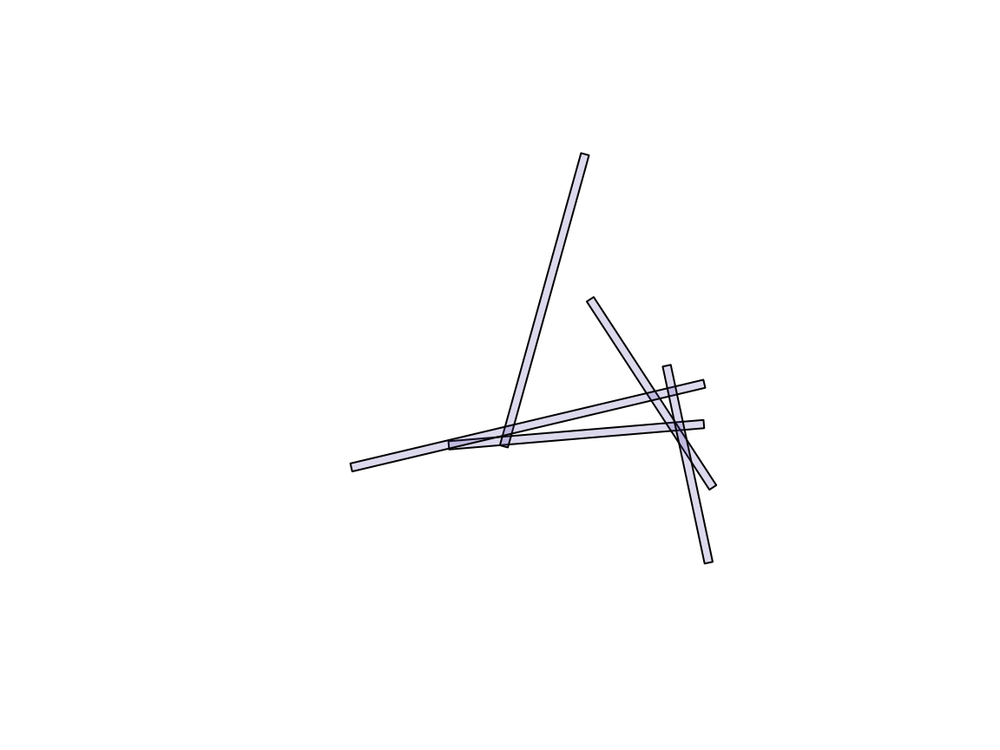

# Overlay robustness: the history of issue 7

This article records polymer [issue
7](https://github.com/hypertidy/polymer/issues/7), “sf handling polygon
intersections”, from its report in January 2020 to October 2026. It
reruns the issue’s examples with the software of today and sets out
where polymer, ‘sf’ and ‘GEOS’ stand on the problem underneath it. That
problem is older than any of these packages: deciding when two computed
points are the same point.

``` r

library(polymer)
sf::sf_extSoftVersion()[c("GEOS", "GDAL", "PROJ")]
#>     GEOS     GDAL     PROJ 
#> "3.12.1"  "3.8.4"  "9.4.0"
```

The results below come from the ‘GEOS’ version printed above, which is
whatever the machine that built this page has. Where the text quotes
numbers it says which version they came from.

## The report (2020)

The issue opened with a minimal example: ten random line segments,
buffered by 1 unit with flat end caps, then the n-ary intersection of a
subset of five with
[`sf::st_intersection()`](https://r-spatial.github.io/sf/reference/geos_binary_ops.html).
At the time this stopped with

    TopologyException: found non-noded intersection between
    LINESTRING (31.116 34.6469, 32.3567 32.7435) and
    LINESTRING (-7.05113 31.4604, 33.1976 34.8206) at
    31.115984892808036 34.646855583109961

The discussion that followed found three things that recur through the
rest of this history:

- Removing a buffer far from the reported location made the error go
  away. The failure was not local to the geometry involved.
- Rounding the input coordinates to six significant figures fixed this
  data set, but not data sets in general, and buffering reintroduces
  long coordinates anyway.
- Plotting the reported segment and point showed the point does not lie
  on the segment it was computed from.

The example data are reproduced here without the ‘sfheaders’ and
‘tibble’ packages used in the original.

``` r

d <- data.frame(
  x = c(-21.5621127514169, 40.2962636668235, -31.1925547663122,
        -22.5405948469415, -23.0838318355381, 29.9605491571128,
        11.478958860971, -8.19494309835136, 42.4840283580124,
        12.7380638383329, 40.4127392685041, -45.2017169678584,
        16.2871447857469, -3.90106798149645, 41.4583092322573,
        31.2947675585747, -22.8197822580114, -10.0503325928003,
        -19.7022920008749, -29.5000644400716),
  y = c(29.2453840607777, 34.4098202185705, 98.7871219869703,
        60.797041747719, 3.01325886975974, 11.2556441454217,
        99.8579441336915, 29.0021185064688, 19.0383932320401,
        64.6716579562053, 44.1835718695074, 23.8893277477473,
        83.8549552252516, 62.2791656060144, 0.788207678124309,
        48.5741916345432, 73.8897712901235, 12.106719147414,
        42.6758473273367, 22.9514547623694))

## one segment from each consecutive pair of rows
lines_from <- function(d) {
  m <- as.matrix(d[c("x", "y")])
  sf::st_sfc(lapply(seq_len(nrow(m) / 2), function(i) {
    sf::st_linestring(m[c(2 * i - 1, 2 * i), ])
  }))
}
buffered <- function(lines, width = 1) {
  sf::st_sf(geometry = sf::st_buffer(lines, width, endCapStyle = "FLAT"))
}

b <- buffered(lines_from(d)[c(1, 4, 5, 6, 8)])
plot(sf::st_geometry(b), col = "#5142A533")
```



## Timeline

| Date | Event |
|:---|:---|
| 2020-01 | Issue opened with the example above and the `TopologyException`. |
| 2020-12 | GEOS 3.9.0 makes the OverlayNG engine the default for overlay. |
| 2023-02 | The original example now succeeds (GEOS 3.9.3); 100 random buffered lines still fail with a GEOS exception. |
| 2023-04 | Experiments with fixed-precision overlay (`grid_size`) in the ‘geos’ R package: a coarse grid succeeds but moves the geometry visibly; a very fine grid still fails at 100 lines. |
| 2026-09 | GEOS 3.15.0 released. |
| 2026-10 | The failure is restated as a vertex-identity problem (below). polymer 0.3.0 is rebuilt on ‘wkpool’ and ‘cdtr’. An exact-arithmetic constrained triangulation appears on a branch of ‘laridae’. |

GEOS releases have continued to work on overlay: 3.14.0 (August 2025)
and 3.15.0 (September 2026), whose
[NEWS](https://github.com/libgeos/geos/blob/3.15.0/NEWS.md) includes a
fix to the intersection of slightly overlapping polygons (GH-1499).
Results for both 3.12.1 and 3.15.0 are recorded below.

## What goes wrong: vertex identity

Every overlay has to decide when two points are the same vertex. The
choices form a ladder, described in more detail in [notes on triangles
in
GeoArrow](https://mdsumner.github.io/trianglewins/dev-drafts/geoarrow-triangles/):

1.  **Exact equality** of input coordinates. Points are the same only if
    their doubles are identical.
2.  **Tolerance or snapping.** Points within a distance, or on the same
    grid cell, are merged. Robust, but it moves the geometry.
3.  **Noding in double precision.** Where two edges cross, the crossing
    is computed and inserted as a new vertex on both. The computed point
    is rounded to the nearest double, so in general it lies on neither
    edge.
4.  **Exact arithmetic.** Crossings are held as rational numbers, so
    they lie exactly on both edges and every later test about them is
    exact.

The 2020 error is a rung 3 failure. Where several buffered edges cross
almost at one point, the rounded crossings do not lie on their edges,
the noded result fails validation, and which crossings exist at all
depends on every other edge in the input. That is why removing a distant
buffer changed the outcome.

Where the tools sit on the ladder:

- **GEOS.** OverlayNG first nodes in floating precision (rung 3) and
  validates the result. If noding fails, it retries with snapping noders
  at automatically chosen tolerances (rung 2), and throws the original
  `TopologyException` only if those fail too. Fixed-precision overlay
  with snap rounding (`grid_size` in ‘geos’ and ‘shapely’,
  [`sf::st_set_precision()`](https://r-spatial.github.io/sf/reference/st_precision.html)
  in ‘sf’) is rung 2 by request.
- **polymer.** Vertices are first shared on exact coordinate equality
  with ‘wkpool’ (rung 1). All edges of all layers then go into one
  constrained triangulation with ‘cdtr’, which binds the CDT library.
  Its orientation tests use adaptive exact predicates, but crossings are
  computed by interpolation in double (rung 3).
- **Exact kernels.** CGAL’s exact-predicates-exact-constructions kernel
  is rung 4, at a cost in speed and memory. The `exact-cdt` branch of
  ‘laridae’ has a one-shot constrained triangulation with exact
  crossings, `lari_cdt(exact = TRUE)`, built on it.

## Rerunning the examples

The original five-buffer example, then all ten buffers:

``` r

nary_sf <- function(x) {
  r <- try(sf::st_intersection(x), silent = TRUE)
  if (inherits(r, "try-error")) conditionMessage(attr(r, "condition")) else r
}
r5 <- nary_sf(b)
r10 <- nary_sf(buffered(lines_from(d)))
c(five = NROW(r5), ten = NROW(r10))
#> five  ten 
#>   14   24
```

And the 2023 stress test: 100 random segments, buffered the same way.

``` r

stress <- function(seed, n = 200) {
  set.seed(seed)
  buffered(lines_from(data.frame(x = runif(n, -50, 50), y = runif(n, 0, 100))))
}
x <- stress(3)
t_sf <- system.time(r <- nary_sf(x))[["elapsed"]]
t_polymer <- system.time(pieces <- fuse(polymer(x)))[["elapsed"]]
c(sf_ok = is.data.frame(r), sf_seconds = t_sf, polymer_seconds = t_polymer)
#>           sf_ok      sf_seconds polymer_seconds 
#>           1.000           8.362           0.439
```

With GEOS 3.12.1 and 3.15.0 none of these throw. Across ten random seeds
of the stress test, every `st_intersection()` call succeeded with both
versions, taking 8 to 29 seconds per seed against 0.2 to 0.45 seconds
for `fuse(polymer(x))`.

### Success is not the same as correct

The n-ary intersection is a partition of the covered area, so its pieces
satisfy two identities that need nothing but areas:

- area weighted by the overlap count equals the summed area of the
  inputs;
- plain area equals the area of the union of the inputs.

``` r

identities <- function(area, n, x) {
  c(weighted = sum(area * n) / sum(as.numeric(sf::st_area(x))) - 1,
    union = sum(area) / as.numeric(sf::st_area(sf::st_union(x))) - 1)
}
a_sf <- as.numeric(sf::st_area(r))
a_polymer <- as.numeric(sf::st_area(sf::st_as_sf(pieces)))
rbind(sf = identities(a_sf, r$n.overlaps, x),
      polymer = identities(a_polymer, pieces$n, x))
#>            weighted        union
#> sf      0.002949908 1.068599e-03
#> polymer 0.000000000 6.661338e-16
```

With GEOS 3.12.1, the ‘sf’ pieces for this seed add up to about 0.1%
more than the union, so some of them overlap, and the overlap-weighted
area is off by 0.3%. The polymer pieces satisfy both identities to
rounding, because they are dissolved from one mesh and cannot overlap by
construction.

The same check over all ten seeds, recorded once rather than run here
(relative errors of the ‘sf’ result; polymer was within 1e-15 on every
seed):

``` r

for (seed in 1:10) {
  x <- stress(seed)
  r <- sf::st_intersection(x)
  print(identities(as.numeric(sf::st_area(r)), r$n.overlaps, x))
}
```

| seed | weighted, 3.12.1 | union, 3.12.1 | weighted, 3.15.0 | union, 3.15.0 |
|-----:|-----------------:|--------------:|-----------------:|--------------:|
|    1 |         -1.9e-04 |       1.6e-04 |          7.0e-04 |       1.8e-04 |
|    2 |          6.0e-06 |       6.2e-06 |          9.7e-05 |       9.9e-05 |
|    3 |          2.9e-03 |       1.1e-03 |          8.2e-05 |       1.4e-04 |
|    4 |          7.3e-04 |       6.1e-04 |          1.3e-03 |       6.4e-04 |
|    5 |          8.5e-04 |       5.4e-04 |          2.9e-05 |       5.3e-05 |
|    6 |          5.4e-05 |       1.2e-04 |         -4.3e-04 |       3.7e-04 |
|    7 |          2.3e-03 |       2.0e-04 |         -5.5e-05 |      -1.1e-04 |
|    8 |          4.3e-07 |       7.5e-07 |          3.4e-05 |       3.2e-05 |
|    9 |          6.4e-04 |       1.2e-03 |          4.2e-05 |       2.0e-05 |
|   10 |          1.2e-03 |       1.6e-03 |          2.9e-05 |       8.5e-05 |

The errors change from one version to the next but do not go away, and
they take both signs: a positive union error means pieces overlap, a
negative one means gaps between them. The 3.15.0 runs used a GEOS built
from the release source and loaded in place of the system library. Area
per overlap count shows where the two disagree:

``` r

rbind(sf = tapply(a_sf, r$n.overlaps, sum),
      polymer = tapply(a_polymer, pieces$n, sum))
#>                1        2        3        4        5        6       7        8
#> sf      3036.068 1607.229 674.0507 232.4412 51.89470 8.726565 1.56102 0.156478
#> polymer 3034.046 1613.130 671.8727 225.2509 51.39387 8.726565 1.56102 0.156478
```

The ‘sf’ result also mixes in lower-dimensional pieces where boundaries
touch:

``` r

table(as.character(sf::st_geometry_type(r)))
#> 
#> GEOMETRYCOLLECTION         LINESTRING    MULTILINESTRING         MULTIPOINT 
#>                884                 82                 55                 20 
#>       MULTIPOLYGON              POINT            POLYGON 
#>                292                 46               1314
```

Pieces of a partition can touch but never overlap, so
[`sf::st_overlaps()`](https://r-spatial.github.io/sf/reference/geos_binary_pred.html)
should find no pairs among them. The helper below counts directed hits,
and the pairs that are reported in only one direction:

``` r

overlap_pairs <- function(g) {
  o <- try(sf::st_overlaps(g), silent = TRUE)
  if (inherits(o, "try-error")) return(conditionMessage(attr(o, "condition")))
  m <- as.matrix(o)
  c(hits = sum(m), one_way = sum(m != t(m)))
}
overlap_pairs(sf::st_geometry(r)[a_sf > 0])
#> [1] "TopologyException: side location conflict at -20.848947450598626 76.03557089123953. This can occur if the input geometry is invalid."
overlap_pairs(sf::st_geometry(sf::st_as_sf(pieces)))
#>    hits one_way 
#>       0       0
```

With GEOS 3.12.1 the test on the ‘sf’ pieces raised a new
`TopologyException` (“side location conflict”): the exception had moved
from computing the overlay to using its output. With GEOS 3.15.0 it ran
and reported about 17,600 hits, 14 of them in one direction only. The
intersection of a sample reported pair had zero area, so the pieces
cross each other along shared boundaries at the scale of rounding. The
polymer pieces gave no hits with either version.

## Where polymer still fails

polymer is on rung 3 as well, and the failures show up in the same
places.

**Near-coincident input.** The ‘sf’ pieces above are many thin slivers
with almost-shared edges. Overlaying them again with polymer stops in
the triangulation:

``` r

slivers <- sf::st_collection_extract(r, "POLYGON")
res <- try(polymer(slivers), silent = TRUE)
if (inherits(res, "try-error")) cat(res) else res
#> Error : Intersection of constraint edges (39, 92) and (38, 43) can not be resolved: computed split vertex is invalid
#> in 'insertEdgeIteration' at CDT/Triangulation.hpp:659
```

CDT computed a crossing of two nearly parallel constraint edges, the
rounded point fell outside where it must be, and CDT refused it.

**Degenerate triangles.** At 500 buffered segments, one seed in ten
built a mesh but failed in
[`fuse()`](https://hypertidy.github.io/polymer/reference/fuse.md):

``` r

x500 <- stress(2, n = 1000)
pool <- polymer(x500)
res <- try(fuse(pool), silent = TRUE)
if (inherits(res, "try-error")) cat(res) else nrow(res)
#> [1] 124328
```

Here the mesh holds a triangle whose three vertices are collinear in
double precision. Its area is exactly zero, so
[`fuse()`](https://hypertidy.github.io/polymer/reference/fuse.md) cannot
tell whether its boundary is an outer ring or a hole. A guard for
zero-area triangles would let
[`fuse()`](https://hypertidy.github.io/polymer/reference/fuse.md)
continue, but the triangle is a symptom of rung 3, not the cause.

## Where things stand

- **sf and GEOS.** For this issue’s inputs, the exceptions of 2020 and
  2023 are gone: OverlayNG’s fallback to snapping is doing its job. The
  remaining problems are speed, which grows quickly with the number of
  overlaps, and output that is valid geometry piece by piece but not a
  partition, with GEOS 3.12.1 and 3.15.0 alike. These results should be
  rechecked against newer versions as they appear.
- **polymer.** One triangulation of all edges is much faster on these
  inputs and gives an exact partition of whatever mesh it builds. The
  mesh itself still depends on double-precision crossings, and fails on
  near-coincident or near-collinear input.
- **Next.** The plan recorded in the issue is to move polymer’s
  triangulation to rung 4: build the mesh with exact crossings (as in
  `lari_cdt(exact = TRUE)`), classify triangles by layer and feature
  exactly as now, and round to doubles only for output. The 100-segment
  stress test, the sliver re-overlay and the degenerate triangle above
  are the test cases.
