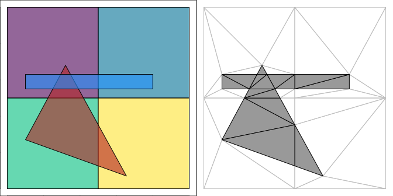
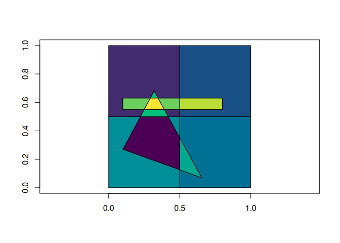
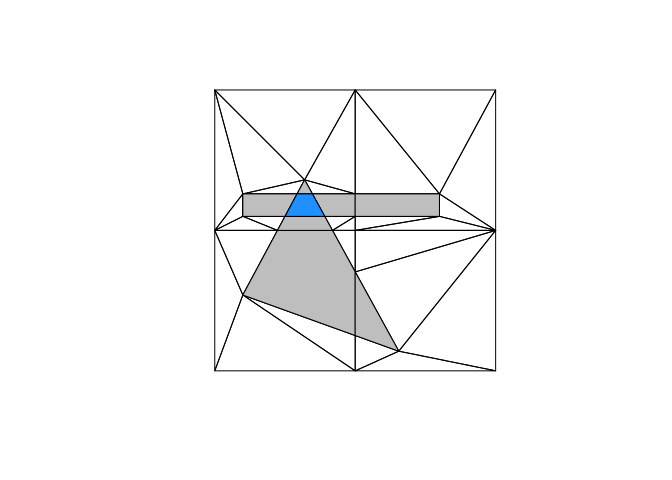
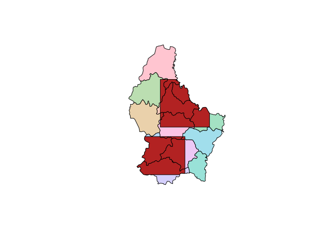

# polymer

polymer overlays any number of polygon layers at once. Every edge from
every input goes into one constrained triangulation, crossings become
new vertices, and each triangle records which input features cover it.
From that mesh and its index you can ask where features overlap, how
many times, and which features are involved, and get the overlay pieces
back as polygons.

The plot on the left shows three overlapping layers: four squares, a
triangle, and a thin rectangle. On the right is the polymer mesh, with
the triangles covered more than once filled in.



## Installation

Once polymer is on CRAN, install it with:

``` r

install.packages("polymer")
```

The development version is on GitHub:

``` r

# install.packages("remotes")
remotes::install_github("hypertidy/polymer")
```

## Example

[`polymer()`](https://hypertidy.github.io/polymer/reference/polymer.md)
takes the layers, as anything the ‘wk’ package can read: ‘sf’ data
frames,
[`wk::wkb()`](https://paleolimbot.github.io/wk/reference/wkb.html) or
[`wk::wkt()`](https://paleolimbot.github.io/wk/reference/wkt.html)
vectors and so on.

``` r

library(polymer)
pool <- polymer(A, B, C)
pool
#> polymer mesh:
#> Layers:    3
#> Features:  6
#> Triangles: 42
#> Vertices:  26 (10 at crossings)
#> Overlaps:  15 triangles covered more than once, at most 3 deep
```

The index has one row for each triangle and each feature covering it,
with the layer and the row of the feature in that layer.

``` r

head(pool$index)
#>   triangle layer feature
#> 1        1     1       3
#> 2        1     2       1
#> 3        2     1       1
#> 4        3     1       1
#> 5        4     1       2
#> 6        5     1       4
```

[`fuse()`](https://hypertidy.github.io/polymer/reference/fuse.md)
dissolves the mesh into overlay pieces: one polygon for each distinct
set of covering features. The pieces form an exact partition, so
neighbouring pieces share their vertices.

``` r

pieces <- fuse(pool)

## pieces by the number of features covering them
table(pieces$n)
#> 
#> 1 2 3 
#> 4 5 1

## the deepest piece and the features that make it
deepest <- which.max(pieces$n)
pieces$geometry[deepest]
#> <wk_wkb[1] with CRS=NA>
#> [1] <MULTIPOLYGON (((0.2931707 0.63, 0.2502439 0.55, 0.3913934 0.55, 0.347459 0.63, 0.2931707 0.63)))>
pieces$origins[[deepest]]
#>   layer feature
#> 1     1       1
#> 2     2       1
#> 3     3       1

plot(wk::wk_bbox(A), border = NA)
wk::wk_plot(pieces$geometry, col = hcl.colors(nrow(pieces)), add = TRUE)
```



[`layer_n()`](https://hypertidy.github.io/polymer/reference/fuse.md)
keeps the pieces covered at least `n` times.

``` r

plot(pool)
wk::wk_plot(layer_n(pool, 2)$geometry, col = "grey", add = TRUE)
wk::wk_plot(layer_n(pool, 3)$geometry, col = "dodgerblue", add = TRUE)
```



Geometry comes back as
[`wk::wkb()`](https://paleolimbot.github.io/wk/reference/wkb.html) with
the inputs’ coordinate reference system, and converts to ‘sf’ with
[`sf::st_as_sf()`](https://r-spatial.github.io/sf/reference/st_as_sf.html).

``` r

soil_field <- polymer(soil, field)
x <- sf::st_as_sf(layer_n(soil_field, 2))
plot(sf::st_geometry(soil), col = hcl.colors(nrow(soil), "Pastel 1"))
plot(sf::st_geometry(x), col = "firebrick", add = TRUE)
```



## Why a mesh

GIS overlay usually clips polygons in pairs. With many overlapping
inputs that gets slow, and each pairwise step recomputes crossings in
floating point, so the pieces can end up overlapping each other or
missing slivers. polymer finds every crossing once, in one
triangulation, and builds the pieces from triangles, so the result is a
partition by construction.

On 100 overlapping buffered lines in one layer (the example from [issue
7](https://github.com/hypertidy/polymer/issues/7)),
[`polymer()`](https://hypertidy.github.io/polymer/reference/polymer.md)
plus [`fuse()`](https://hypertidy.github.io/polymer/reference/fuse.md)
takes under a second and its pieces add up exactly, where
[`sf::st_intersection()`](https://r-spatial.github.io/sf/reference/geos_binary_ops.html)
takes tens of seconds and its pieces overlap each other by a small
amount.

The mesh itself is a ‘wkpool’ triangle pool on a shared vertex table,
and the triangulation comes from ‘cdtr’. Vertices are shared on exact
coordinate equality; crossings are computed in double precision.

## Background

polymer is modelled on the idea of *data fusion* from Eonfusion, a
commercial package that is no longer available: a single mesh that keeps
lossless links to all of its inputs, from which overlay results are
derived rather than computed one pair at a time. This is what GIS
packages variously call overlay, topology overlay or n-ary intersection.

------------------------------------------------------------------------

Please note that the polymer project is released with a [Contributor
Code of
Conduct](https://www.contributor-covenant.org/version/1/0/0/code-of-conduct.html).
By contributing to this project, you agree to abide by its terms.
